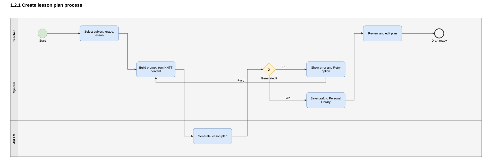
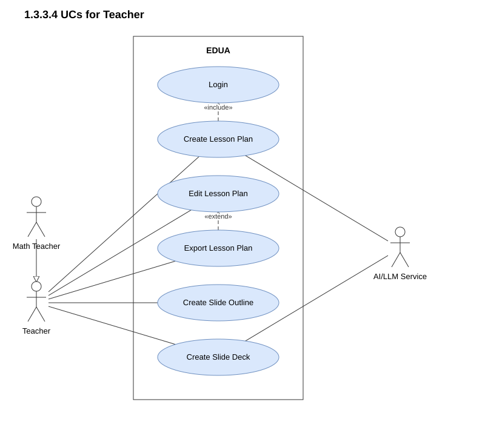

# II. Software Requirement Specification

## 1. Overall Requirements

### 1.2 Main Workflows

#### 1.2.1 Create lesson plan process

Description: The teacher selects the teaching content, the system builds the prompt, the AI/LLM generates the plan and the system saves it as a draft.

| # | Actor | Condition | Action |
|---|---|---|---|
| 1 | Teacher | None | Selects the subject, grade and lesson, then selects Create Lesson Plan. |
| 2 | System | None | Builds the prompt from the selected KNTT content and the MOET 5512 structure. |
| 3 | AI/LLM | None | Generates the lesson-plan title, objectives, equipment and teaching activities. |
| 4 | System | Not generated successfully | Displays an inline error with a Retry option (MSG163). |
| 4a | Teacher | Not generated successfully | Selects Retry; the workflow returns to Step 2. |
| 5 | System | Generated successfully | Saves the draft to the Personal Library and opens the Lesson Plan Editor. |

### 1.3 User Requirements

#### 1.3.1 Actors

| # | Actor | Description |
|---|---|---|
| 1 | Teacher | A STEM teacher who creates lesson plans, slides and homework. |
| 2 | Math Teacher | A Mathematics teacher (grades 10-12). Inherits all capabilities of Teacher. |
| 3 | AI/LLM Service | External service that generates teaching content from structured prompts. |

#### 1.3.2 Use Cases (UC)

| ID | Use Case | Feature | Use Case Description |
|---|---|---|---|
| UC-05 | Create Lesson Plan | Lesson Plan | The teacher selects the subject, grade and lesson. The system asks the AI/LLM Service to generate the plan and saves it to the library as Draft. |

#### 1.3.3 Use Case Diagrams

##### 1.3.3.4 UCs for Teacher

